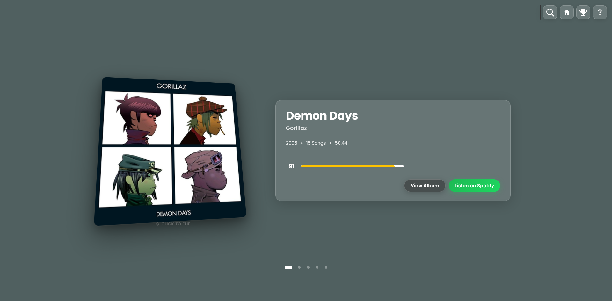

# VinylCollection



A personal vinyl collection site: browse albums in a carousel, see them ranked by rating, and open each one for its tracks and a Spotify player. Each page takes its colour from the album cover.

**Live site:** https://vinyl-collection.co.uk

Built with Blazor Server (.NET 9), stored in Azure Cosmos DB, and hosted on Azure App Service.

## How it works

- **Read-only app.** The site never writes data. Albums are managed directly in Cosmos DB (see [Managing albums](#managing-albums)).
- **One document per album.** Each album is a document in the `Albums` container, partitioned on `/id`, with its tracks embedded.
- **No keys in Azure.** The web app reads Cosmos DB with its managed identity, which has the read-only *Cosmos DB Built-in Data Reader* role.
- **Cover colours.** Each album's `PrimaryColour` is the dominant colour of its cover. The import tool calculates and stores it. If it's missing, pages calculate it on load without saving it.

## Project structure

```
FRONTEND/              Blazor Server app
  Components/Pages/    Home (carousel), Ranking, AlbumView, Help
  Components/Shared/   Search, Rating, LoadingScreen
  Data/                Album and Track models, VinylDbContext (EF Core Cosmos)
  Services/            VinylService (queries), ColorAnalysisService (cover colours)
  Dockerfile
tools/CosmosImport/    One-off import of albums.json into Cosmos DB
infra/                 Bicep for all Azure resources
.github/workflows/     deploy.yml: deploys the infrastructure, then the app, on push to master
docker-compose.yml     Runs the app locally in Docker
```

## Running locally

### Prerequisites

- [.NET 9 SDK](https://dotnet.microsoft.com/download/dotnet/9.0)
- A Cosmos DB connection string, from the Azure portal: `slk-vc-cosmos-uks` → **Settings → Keys**

Only .NET 10 installed? Set `DOTNET_ROLL_FORWARD=Major` to run on it. Blazor's interactive features won't work that way, though, because `blazor.web.js` isn't served. Use Docker for a faithful local run.

### Connection string

Copy `.env.example` to `.env` in the repo root and fill in `Cosmos__ConnectionString`. The app (when running as `Development`), Docker Compose and the tools in `tools/` all read it. `.env` is git-ignored.

### With dotnet

From `FRONTEND/`:

```bash
dotnet watch run
```

It runs at http://localhost:5052. User-secrets or environment variables override `.env` if set.

### With Docker

```bash
docker compose up --build
```

It runs at http://localhost:8080. The container uses the same .NET 9 runtime as Azure, so it's the best way to test interactive behaviour.

## Managing albums

### Initial import

The tools in `tools/` read `Cosmos__ConnectionString` from the repo's `.env`, the same file Docker uses. A connection string passed on the command line, or set as an environment variable, takes precedence.

`tools/CosmosImport` loads `albums.json` into an **empty** `Albums` container and calculates each cover's colour. If the container already has data, it does nothing. From `tools/CosmosImport`:

```bash
dotnet run
```

### Adding or editing albums

Use **Data Explorer** on the Cosmos DB account in the Azure portal. Each album is one document:

```json
{
  "id": "any-unique-string",
  "Name": "IGOR",
  "Artist": "Tyler the Creator",
  "Rating": 90,
  "Release": 2019,
  "Length": 39.7,
  "ImgSrc": "https://.../front.jpg",
  "ImgSrcBack": "https://.../back.jpg",
  "BannerImg": "https://.../banner.jpg",
  "BestTrack": "EARFQUAKE",
  "SpotifyLink": "https://open.spotify.com/album/...",
  "SpotifyiFrame": "https://open.spotify.com/embed/album/...",
  "PrimaryColour": "#F0B0C0",
  "TrackList": [
    { "Name": "IGOR'S THEME", "Length": 3.21 }
  ]
}
```

- **`id`, `Name` and `Artist` are required.** Album URLs are built from `Name` (`/album/igor`), so a document without one breaks navigation.
- **Missing optional fields are fine.** Numbers default to 0, and a missing `TrackList` shows as no tracks.
- **Include `PrimaryColour` when you can.** Without it, the colour is recalculated from the cover on every page load.

## Azure infrastructure

Everything is defined in [infra/main.bicep](infra/main.bicep) and deployed to the resource group `slk-vc-rg-uks` (UK South). Resource names follow `slk-vc-[type]-[region]`:

| Resource | Name | Notes |
|---|---|---|
| App Service plan | `slk-vc-asp-uks` | Linux, B1 |
| Web app | `slk-vc-app-uks` | .NET 9; WebSockets and session affinity on for Blazor Server; system-assigned identity |
| Cosmos DB account | `slk-vc-cosmos-uks` | Serverless; database `VinylCollection`, container `Albums` |
| Managed certificate | `slk-vc-cert-uks` | Free App Service certificate for `vinyl-collection.co.uk` |

### Deployment

[deploy.yml](.github/workflows/deploy.yml) runs on every push to `master`. It deploys the Bicep, then publishes the app to the web app.

The pipeline signs in to Azure with OIDC, so there are no stored passwords. It needs three repository secrets: `AZURE_CLIENT_ID`, `AZURE_TENANT_ID` and `AZURE_SUBSCRIPTION_ID`.

The app registration's federated credential must match the subject GitHub sends. This repo uses the ID-based format:

```
repo:samlkey-labs@316934009/vinyl-collection@1334100024:ref:refs/heads/master
```

To check or change the infrastructure by hand:

```bash
az deployment group what-if -g slk-vc-rg-uks -f infra/main.bicep -p infra/main.bicepparam
```

In Git Bash, prefix `az` commands that take `/subscriptions/...` arguments with `MSYS_NO_PATHCONV=1`.

### Custom domain

DNS for `vinyl-collection.co.uk` is hosted at GoDaddy:

| Record | Host | Value |
|---|---|---|
| A | `@` | The web app's inbound IP |
| TXT | `asuid` | The web app's custom domain verification ID |

The managed certificate is only issued once the domain resolves to the app. So a fresh setup deploys in two passes, controlled by `customDomainCertificate` in [main.bicepparam](infra/main.bicepparam):

1. `false`: adds the domain to the app without HTTPS.
2. Point the A record at the app.
3. `true`: issues the certificate and binds it with SNI SSL.

## Troubleshooting

To stream the app's logs:

```bash
az webapp log tail -g slk-vc-rg-uks -n slk-vc-app-uks
```

This needs container logging set to `filesystem`. To turn it on:

```bash
az webapp log config -g slk-vc-rg-uks -n slk-vc-app-uks --docker-container-logging filesystem
```

- **"An unhandled error has occurred" bar:** the Blazor connection hit an exception. The log shows it as `Unhandled exception in circuit`.
- **Cosmos 401 or 403 errors:** after rotating a key, it takes a few minutes for the new one to work. The web app's managed identity needs the Data Reader role on the account, which the Bicep assigns.
